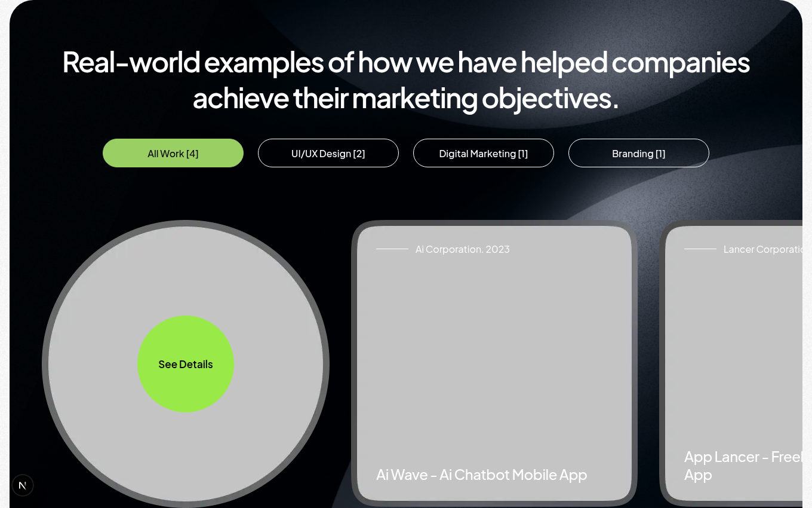
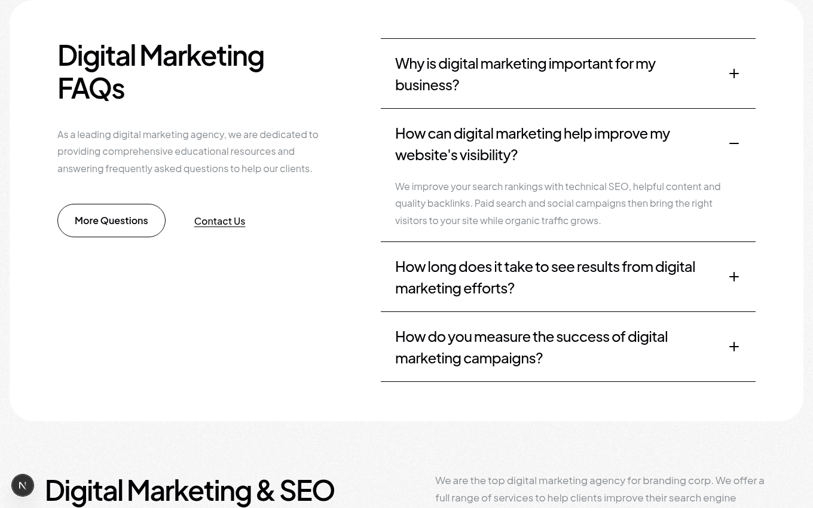

# SEO agency landing page

## Filter agency case studies

The **View Case Study** link jumps to the portfolio. Choose **UI/UX Design**, **Digital Marketing**, or **Branding** to filter the project cards. The gallery includes two UI/UX projects and one project in each of the other categories.



### Read a service FAQ

Select a question under **Resources** to expand its answer.



## Run locally

```sh
npm ci
npm run dev
```

Open http://localhost:3000. The page composition lives in `app/page.tsx`. Edit the case-study dataset in `components/Portfolio.tsx` and the questions in `components/Faq.tsx`.
